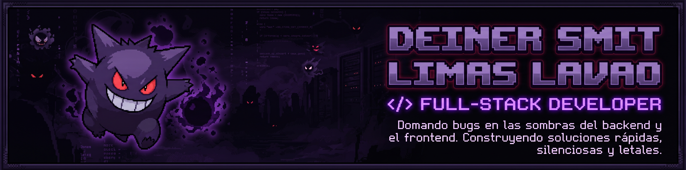

<!-- BANNER PRINCIPAL PIXEL ART GENGAR -->

  

 

<!-- TYPING SVG (EFECTO DE ESCRITURA EN MORADO NEÓN) -->

  

<!-- BADGES DE ESTADO Y ROL -->

  
  
  
  

---

###  `> whoami` // Sobre Mí | About Me

<table>
  <tr>
    <td width="72%" valign="top">
      
<b>ES 🇨🇴</b> — ¡Hola! Soy <b>Deiner Smit Limas Lavao</b>, <b>Técnico en Sistemas Teleinformáticos</b> y estudiante de <b>Tecnología en Análisis y Desarrollo de Software (ADSO)</b> en el SENA. Me enfoco en el desarrollo <b>Full-Stack</b> de aplicaciones web y móviles utilizando PHP, JavaScript, TypeScript, MySQL, PostgreSQL, HTML5 y CSS3. He trabajado en proyectos académicos y personales, incluyendo una aplicación desplegada en producción y proyectos liderados en equipo mediante la metodología <b>Scrum</b> y planes de aseguramiento de calidad (QA).

      
Actualmente estoy fortaleciendo mis conocimientos en <b>Java, Spring Boot y React</b>. Busco mi primera oportunidad como <b>Trainee Software Developer</b>, donde pueda aportar, aprender de un equipo y crecer profesionalmente.

      

      
<b>EN 🇬🇧</b> — I am a <b>Telecommunications Systems Technician</b> and a <b>Software Analysis and Development</b> student at SENA. I focus on full-stack web development using PHP, JavaScript, MySQL, HTML, and CSS. I have worked on academic and personal projects, including a deployed web application in production and a team project led using the <b>Scrum</b> methodology.

      
I am currently improving my skills in <b>Java, Spring Boot, and React</b>. I am looking for my first opportunity as a <b>Trainee Software Developer</b>, where I can contribute, learn from a team, and grow professionally.

      <blockquote>
        🎯 <b>Objetivo / Goal:</b> Conseguir una oportunidad como <b>Trainee Software Developer</b>. 
        ⚡ <b>Filosofía:</b> <i>"En las sombras del backend o en el brillo del frontend, cada línea cuenta para lograr un rendimiento fantasma: rápido, silencioso y letal contra los bugs."</i>
      </blockquote>
    </td>
    <td width="28%" align="center" valign="middle">
      
        
      <b>#094 GENGAR</b> <i>Shadow Code Spirit</i>
        
      
    </td>
  </tr>
</table>

---

###  `> tech --list` // Arsenal Tecnológico (`Tech Stack`)

| Área | Tecnologías |
| :--- | :--- |
| **Backend** | PHP · Java · Python · Node.js · Spring Boot *(en formación)* |
| **Frontend & Mobile** | JavaScript · TypeScript · HTML5 · CSS3 · Vite · React & React Native *(en formación)* |
| **Bases de datos** | MySQL · PostgreSQL · PostGIS · SQL |
| **Herramientas & SO** | Git · GitHub · Linux · VS Code · APIs REST · Draw.io (UML/ERD) |
| **Metodologías & QA** | Scrum · Control de Calidad (PAC/QA) · Feature Branching & Pull Requests |

 

  

#### **Lenguajes, Frameworks & Herramientas**

 

 

---

###  `> ls ./projects` // Proyectos Destacados | Featured Projects

#### 🛒 TechnoStore — E-commerce Web Application
> **Proyecto SENA** | *Octubre 2026 – Noviembre 2026*

  
  

Plataforma de comercio electrónico orientada a la venta de productos tecnológicos.
- Lideré un equipo de **4 personas** aplicando **Scrum** y planes de control de calidad (QA) para organizar el trabajo y entregar el proyecto.
- Desarrollé funcionalidades de frontend y backend con **PHP, JavaScript, HTML5 y CSS3**.
- Diseñé y gestioné una base de datos **MySQL con 8 tablas, 21 procedimientos almacenados y 4 vistas**.
- Implementé funcionalidades de usuarios, carrito de compras y panel de administración.
- Desplegué la aplicación en producción (**Hostinger**) y gestioné el control de versiones con Git y GitHub.
- **Tecnologías:** `PHP` `JavaScript` `HTML5` `CSS3` `MySQL` `Git` `GitHub` `Scrum`

---

#### 🗳️ Sistema de Votaciones (ELECTOYA) — Proyecto Electoral
> **Proyecto Personal** | *Marzo 2025 – Junio 2025*

  

- Desarrollé una aplicación web Full-Stack para gestionar elecciones estudiantiles.
- Implementé registro de votantes, control de voto único en tiempo real y panel administrativo de conteo de resultados.
- Construí la aplicación con **PHP, JavaScript, HTML5, CSS3 y MySQL**.
- **Tecnologías:** `PHP` `JavaScript` `HTML5` `CSS3` `MySQL`

---

#### 🚀 Otros Proyectos en Desarrollo & Laboratorio

| Proyecto | Arquitectura & Stack | Descripción |
| :--- | :--- | :--- |
| 🍔 **NexoFood** | `React` `Vite` `TS` `Spring Boot` `PostgreSQL` `PostGIS` `Expo` | Plataforma **Full-Stack multi-tenant** web y móvil para gestión de restaurantes, menús interactivos y logística geolocalizada para repartidores independientes. |
| 🤖 **Clasificador IA** | `Python` `AI / ML` | Sistema inteligente de clasificación automatizada para la separación de residuos degradables y no degradables. |

---

###  `> experience & education` // Trayectoria y Formación

<table>
  <tr>
    <td width="50%" valign="top">
      <h4>💼 <code>&gt; experience</code> — Experiencia</h4>
      

        <b>Auxiliar de Mantenimiento Preventivo de Equipos de Cómputo</b> 
        📍 <i>Colegio José Reinel Cerquera · Neiva, Huila</i> 
        🗓️ <i>Mayo 2025 – Octubre 2025</i>
      

      <ul>
        <li>Realicé mantenimiento preventivo a <b>40 equipos de cómputo</b>.</li>
        <li>Ejecuté limpieza de hardware, actualización de software e instalación de sistemas operativos.</li>
        <li>Diagnostiqué fallas y brindé soporte técnico a docentes y estudiantes.</li>
      </ul>
      

      <h4>📜 <code>&gt; certifications</code> — Certificaciones</h4>
      <ul>
        <li><b>Fundamentos de GitHub (Fundamentación de Git y GitHub)</b> — Microsoft Learn · 2026.</li>
      </ul>
    </td>
    <td width="50%" valign="top">
      <h4>🎓 <code>&gt; education</code> — Educación</h4>
      <ul>
        <li>
          <b>Tecnólogo en Análisis y Desarrollo de Software (ADSO)</b> — SENA 
          <i>En curso · Graduación estimada: Junio de 2028.</i>
        </li>
         
        <li>
          <b>Técnico en Sistemas Teleinformáticos</b> — SENA 
          <i>Noviembre de 2025.</i>
        </li>
      </ul>
      

      <h4>🧠 <code>&gt; soft-skills</code> — Habilidades Blandas</h4>
      
<code>Liderazgo</code> · <code>Trabajo en equipo</code> · <code>Resolución de problemas</code> · <code>Aprendizaje autónomo</code> · <code>Comunicación</code>

      

      <h4>🌐 <code>&gt; languages</code> — Idiomas
