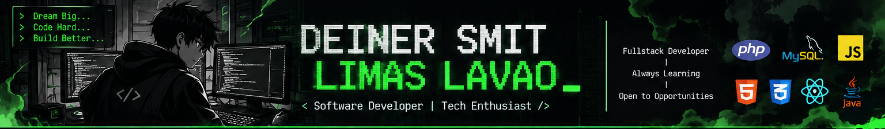

<!--
  Perfil README de GitHub
  Repositorio: deinersmitlimaslavao67/deinersmitlimaslavao67
  Reemplaza los enlaces marcados como PENDIENTE antes de publicar.
-->

<div align="center">



# 👨‍💻 Deiner Smit Limas Lavao

### `Practicante de Desarrollo` · `Soporte Técnico` · `Fullstack Developer`

**Code • Learn • Build • Improve**

[](https://github.com/deinersmitlimaslavao67)
[](mailto:limasdeiner@gmail.com)
[](https://www.linkedin.com/in/tu-perfil/)

📍 Neiva, Huila, Colombia · Disponible para oportunidades Trainee

</div>

---

## `> whoami` — Sobre mí | About me

**ES 🇨🇴**

Soy Técnico en Sistemas Teleinformáticos y estudiante de Tecnología en Análisis y Desarrollo de Software en el SENA. Me enfoco en el desarrollo Fullstack de aplicaciones web utilizando PHP, JavaScript, MySQL, HTML y CSS. He trabajado en proyectos académicos y personales, incluyendo una aplicación desplegada en producción y un proyecto liderado en equipo mediante la metodología Scrum.

Actualmente estoy fortaleciendo mis conocimientos en **Java, Spring Boot y React**. Busco mi primera oportunidad como **Trainee Software Developer**, donde pueda aportar, aprender de un equipo y crecer profesionalmente.

**EN 🇬🇧**

I am a Telecommunications Systems Technician and a Software Analysis and Development student at SENA. I focus on full-stack web development using PHP, JavaScript, MySQL, HTML, and CSS. I have worked on academic and personal projects, including a deployed web application and a team project led using the Scrum methodology.

I am currently improving my skills in **Java, Spring Boot, and React**. I am looking for my first opportunity as a **Trainee Software Developer**, where I can contribute, learn from a team, and grow professionally.

> 🎯 **Objetivo / Goal:** Conseguir una oportunidad como Trainee Software Developer.

---

## `> ls ./projects` — Proyectos destacados | Featured projects

### 🛒 TechnoStore — E-commerce web application

**Proyecto SENA · Oct 2026 – Nov 2026**

[](https://technostore.nexohuila.com/)

- Lideré un equipo de **4 personas** aplicando Scrum para organizar el trabajo y entregar el proyecto.
- Desarrollé funcionalidades de frontend y backend con PHP, JavaScript, HTML y CSS.
- Diseñé y gestioné una base de datos MySQL con **8 tablas, 21 procedimientos almacenados y 4 vistas**.
- Implementé funcionalidades de usuarios, carrito de compras y administración.
- Desplegué la aplicación en Hostinger y gestioné el código con Git y GitHub.

**Tecnologías:** `PHP` `JavaScript` `HTML5` `CSS3` `MySQL` `Git` `GitHub` `Scrum`

### 🗳️ Sistema de Elecciones Estudiantiles — Student Election System

**Proyecto personal · Mar 2025 – Jun 2025**

(([https://github.com/deinersmitlimaslavao67/ELECCIONES.git]))

- Desarrollé una aplicación web para gestionar elecciones estudiantiles.
- Implementé registro de votantes, control de voto único y conteo de resultados.
- Construí la aplicación con PHP, JavaScript, HTML, CSS y MySQL.

**Tecnologías:** `PHP` `JavaScript` `HTML5` `CSS3` `MySQL`

---

## `> tech --list` — Habilidades técnicas | Technical skills

| Área | Tecnologías |
|---|---|
| **Backend** | PHP · Java · Python · Node.js · Spring Boot *(en formación)* |
| **Frontend** | JavaScript · HTML5 · CSS3 · React *(en formación)* |
| **Bases de datos** | MySQL · PostgreSQL · SQL |
| **Herramientas** | Git · GitHub · Linux · VS Code · APIs REST |
| **Metodologías** | Scrum |

### Tecnologías

<div align="center">


</div>

---

## `> git stats` — Estadísticas de GitHub

<div align="center">


</div>

---

## `> experience` — Experiencia

**Auxiliar de Mantenimiento Preventivo de Equipos de Cómputo**  
Colegio José Reinel Cerquera · Neiva, Huila  
*May 2025 – Oct 2025*

- Realicé mantenimiento preventivo a **40 equipos de cómputo**.
- Ejecuté limpieza de hardware, actualización de software e instalación de sistemas operativos.
- Diagnostiqué fallas y brindé soporte técnico a docentes y estudiantes.

---

## `> education` — Educación

- **Tecnólogo en Análisis y Desarrollo de Software** — SENA  
  En curso · Graduación estimada: junio de 2028.
- **Técnico en Sistemas Teleinformáticos** — SENA  
  Noviembre de 2025.

## `> certifications` — Certificaciones

- **Fundamentos de GitHub** — Microsoft Learn · 2026.

## `> soft-skills` — Habilidades blandas

Liderazgo · Trabajo en equipo · Resolución de problemas · Aprendizaje autónomo · Comunicación.

## `> languages` — Idiomas

- **Español:** nativo.
- **Inglés:** B1 — lectura técnica y conversación básica.

---

## `> contact --me` — Contacto | Get in touch

<div align="center">

Estoy abierto a oportunidades de aprendizaje, prácticas y empleo como **Trainee Software Developer**.

I am open to learning opportunities, internships, and Trainee Software Developer positions.

[](mailto:limasdeiner@gmail.com)
[](https://github.com/deinersmitlimaslavao67)
[](https://www.linkedin.com/in/tu-perfil/)

</div>

---

<div align="center">

```bash
> echo "Siempre aprendiendo. Siempre construyendo."
> status: open_to_work
> next_goal: become_a_better_developer()
```

**“Dream big. Code bigger.”** 🚀

</div>

